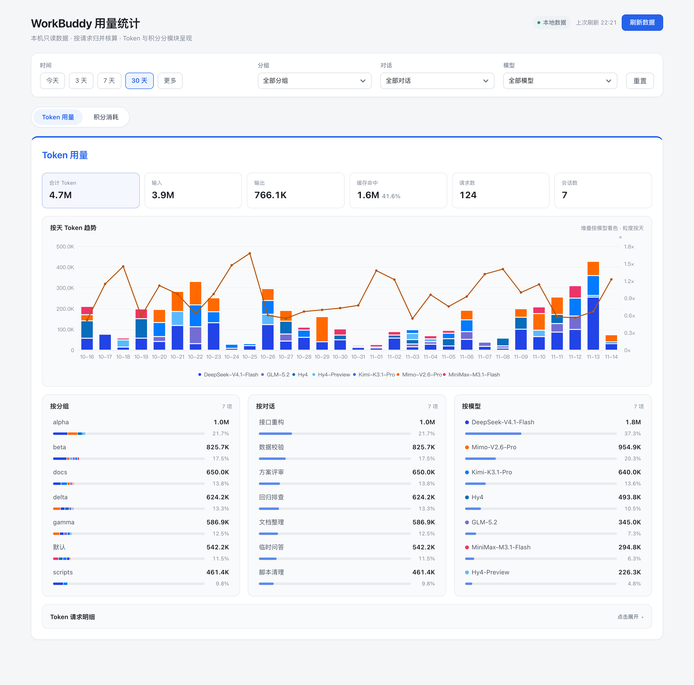
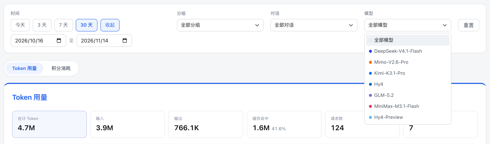
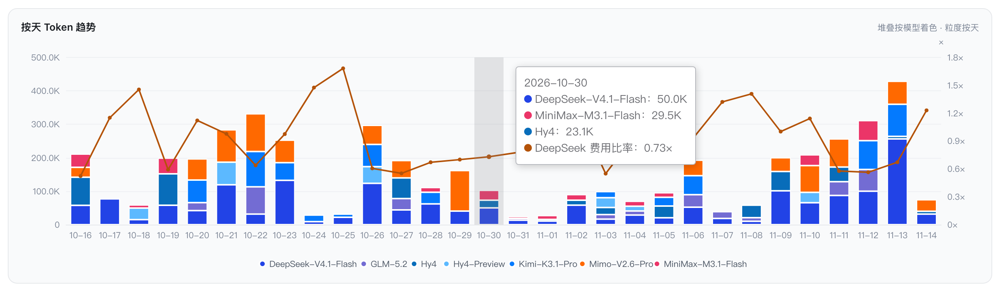
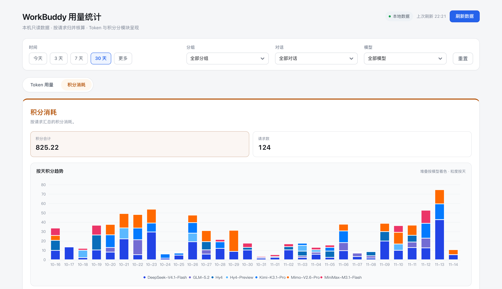
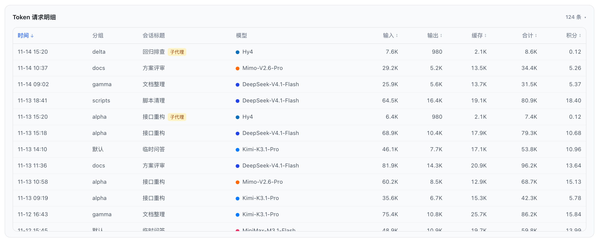

# WorkBuddy 用量统计

  

**把 WorkBuddy 留在本地的会话日志和积分记录，变成一块可筛选、可拆分、可追溯的用量面板。**

WorkBuddy 会把每次对话的 token 用量写进 `~/.workbuddy/projects/**/*.jsonl`，把积分写进 `~/.workbuddy/workbuddy.db`。这些数据面向运行而非面向使用者：想知道「这一周花了多少、花在哪些分组和模型上」，只能逐个会话翻日志。这个面板把原始数据只读地汇总成一块本地 Web 页面，不需要账号、不联网、不改动 WorkBuddy 的任何文件。



> 截图统一切到 30 天区间（面板默认仍是近 3 天），使用演示数据生成；数字为虚构数据，不含真实会话内容。

<details>
<summary>目录</summary>

- [功能特点](#功能特点)
- [界面一览](#界面一览)
- [快速开始](#快速开始)
- [统计边界与已知限制](#统计边界与已知限制)
- [开发与检查](#开发与检查)
- [项目文档](#项目文档)

</details>

## 功能特点

### 数据只留在本机

- **全程只读**：解析 `*.jsonl` 与 `workbuddy.db`（WAL 只读连接），不写入、不搬移、不归档原始数据，也不修改 WorkBuddy 配置。
- **不联网、不上报**：服务不访问网络，没有云端接口、账号体系或遥测；只监听回环地址，`HOST` 设为非回环地址会直接退出。
- **零外部服务**：不需要 Docker、数据库服务或 Python；Node.js 内置的 `node:sqlite` 建一份可随时删除重建的本地库 `.data/database.db`。
- **删库即重建**：本项目数据库只是原始数据的汇总快照，删除后重启会全量重算，原始数据不受影响。

### 一次筛选，贯通两个模块和四个维度

- **Token / 积分双模块**：两个 tab 分别看 token 用量与积分消耗，共用同一份筛选；切换 tab 不重置筛选条件和明细表状态。
- **四个筛选条件**：时间（今天 / 3 天 / 7 天 / 30 天快捷区间，或「更多」里的起止日期，单次跨度不超过 100 天）、分组、对话、模型。下拉选项完全由当前数据的聚合结果驱动。
- **筛选即视图**：点击拆分列表中的某一行与在下拉里选中它是同一个动作；指标卡、趋势图、三张拆分表、请求明细全部随一份筛选联动。
- **多维度拆分**：按分组（工作目录）、按对话、按模型分别给出数值与占比；WorkBuddy 自动创建的时间戳目录统一归入「默认」分组，不再淹没筛选列表。
- **请求明细可追溯**：每个 tab 各有一张默认折叠的请求表，展开后按时间降序，可点击表头排序，逐条查看时间、分组、会话标题、模型、四项 token 与积分。

### 按模型着色的趋势与 hover 聚焦

- **按天堆叠趋势**：柱状图按模型分色堆叠，同一模型在不同视图里颜色一致；颜色绑定模型标识而非展示名，跨筛选、跨刷新、模型集合变化都不漂移，同系列模型颜色相近。
- **DeepSeek 费用比率折线**：Token 趋势叠加一条独立折线，用「订阅摊销费用 ÷ 官方刊例等效费用」给出直观对比；分母按每次模型调用的时间戳判高峰 / 空闲档位，逐步计价。口径见 [deepseek 定价说明](docs/deepseek-pricing.md)。
- **hover 聚焦**：指针落在柱段、分组条色段或比率折线上时，其余系列减淡，被聚焦模型在所有日期同时保持常态，tooltip 里的模型行同步减淡。
- **清爽的浮层**：tooltip 只列出当天数值大于 0 的模型并按数值降序，全 0 的日期直接显示「无数据」。

### 口径可复核，刷新不等全量重算

- **逐步用量是事实**：`message.usage` 的四项 token 是「本步值」而非累计快照。每次模型 API 调用单独计量，请求级四项 = 该请求全部步骤之和；上下文压缩造成数值回落也会如实计入，不漏计任何一次调用。
- **按请求归并**：积分、请求数、会话数、日期与维度归属按 `conversationRequestId` 聚合；模型取该请求第一步的标识。
- **固定业务日**：所有时间以绝对时间戳流转，仅在归日、判档、显示时按固定 UTC+8 折算，不随机器时区或系统设置变化。
- **增量刷新**：启动时自动刷新一次，面板「刷新数据」可随时触发；只重解析 size / mtime 变化的 jsonl，通常 1 秒内完成。积分每次刷新都独立重读，晚到的记录不会永久补不上。
- **分层解耦**：字段映射集中在解析层，WorkBuddy 升级改日志格式时，面板与统计口径不用跟着改。

## 界面一览

**筛选栏** —— 快捷时间区间、可展开的起止日期，以及带模型色点的维度下拉；四个快捷区间与日期框双向联动。



**趋势图** —— 按模型堆叠的每日 token、按数值降序的 tooltip，以及橙色的 DeepSeek 费用比率折线；hover 时其余系列自动减淡。



**积分模块** —— 与 Token 模块共用筛选，单独展示积分合计、请求数和按天积分趋势。



**请求明细** —— 默认折叠，展开后逐条核对每次请求的四项 token 与积分，表头可排序、模型带色标。



## 快速开始

### 环境

- **Node.js ≥ 24**（入口会校验版本；项目依赖 `node:sqlite` 的稳定行为）。
- 一台装有 WorkBuddy、本机已有 `~/.workbuddy` 数据的电脑。无需其它依赖或密钥。

### 启动

```bash
cd workbuddy-usage
npm install
npm run build && npm start
```

浏览器打开 <http://127.0.0.1:4620>。首次启动会先全量解析本地日志再监听端口；之后点右上角「刷新数据」做增量更新。

开发时用 `npm run dev`：Vite 面板在 `5173`，API 在 `4620`，前端请求由 Vite 代理转发。

### 可选配置

直接以环境变量提供（服务不会自动加载 `.env.local`）：

- `PORT` — 面板端口，默认 `4620`。
- `HOST` — 监听地址，默认 `127.0.0.1`，只允许回环地址。
- `WORKBUDDY_HOME` — WorkBuddy 数据根目录，默认 `~/.workbuddy`。
- `DATABASE_PATH` — 本项目数据库文件路径，默认 `.data/database.db`。

> [!WARNING]
> 面板展示的是本机完整对话用量，请不要把 `HOST` 改成 `0.0.0.0` 或放到反向代理后面公开访问。切换 `WORKBUDDY_HOME` 后请删除本项目数据库，或用 `DATABASE_PATH` 指向另一个文件，避免旧路径的数据被误判为「文件已不存在」。

## 统计边界与已知限制

- **只统计此刻本地能读到的数据**：WorkBuddy 清理会话后消失的积分与日志不追溯、不估算、不补齐；本地没有独立记账的子代理积分也不补。
- **积分不换算金额**：积分直接取原始记录值，不按 WorkBuddy 计价规则反推；DeepSeek 费用比率只按公开刊例价独立计算，两者不混算，也不展示余额与有效期。
- **时间粒度只有天**：单次筛选跨度上限 100 天（含首尾），前端与 API 共用同一条校验。
- **按需刷新，不是实时监控**：不做文件监听、告警或流式统计。
- **不提供导出**：没有 CSV、图片或分享链接；不提供多用户、账号体系与云端部署。

## 开发与检查

```bash
npm run typecheck   # 独立类型检查
npm test            # Vitest：解析口径、聚合、格式化与图表配置
npm run build       # 服务端 tsc + 前端 Vite 构建
npm run acceptance  # Playwright 交互验收（首次需 npx playwright install chromium）
```

交互验收跑在 `tests/e2e/sample.ts` 生成的固定样本上，不读真实的 `~/.workbuddy`；README 截图另用一份覆盖 30 天的演示数据生成。运行验收时 Node 24 需要在 `PATH` 首位，详见 [devops.md](docs/devops.md)。

## 项目文档

- [产品简报](docs/product-brief.md) — 背景、范围、术语与统计口径
- [技术架构](docs/technical-architecture.md) — 模块划分、数据流、接口与架构决策
- [数据模型](docs/data-model.md) — 事实表、维表与重建规则
- [外部数据对接](docs/integration.md) — jsonl 字段与 WorkBuddy 表结构
- [开发与运维](docs/devops.md) — 环境、配置、验收与回滚
- [模型配色规则](docs/model-colors.md) — 色表、系列前缀与兜底规则
- [DeepSeek 价格对比口径](docs/deepseek-pricing.md) — 价目表、分子分母与已知假设

需求、方案与实施记录按 `<topic>-spec.md` / `<topic>-plan.md` / `<topic>-tasks.md` 放在 [docs/delivery/](docs/delivery/)。
